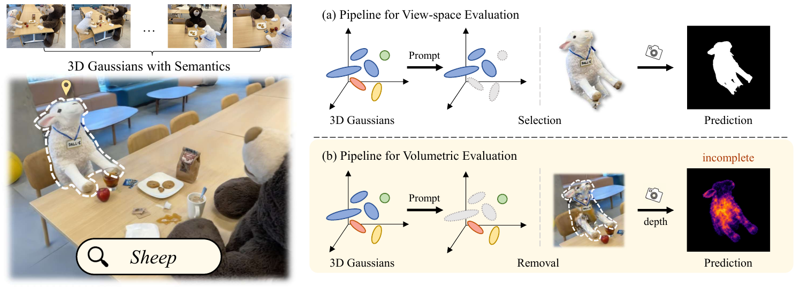
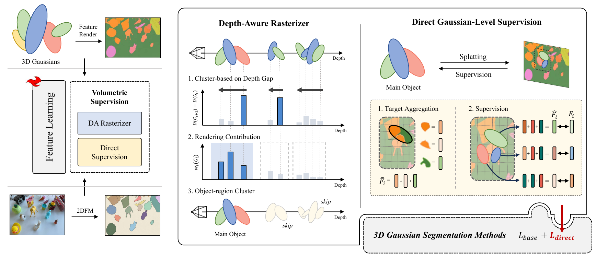

<h1 align="center">The Mask Is Not the Object:<br>Volumetric Supervision for 3D Gaussian Segmentation</h1>

<h3 align="center">
  <b>NeurIPS 2026</b>
</h3>

<p align="center">
  <a href="https://jhxcho.github.io/">Jeonghwan Cho</a> &nbsp;·&nbsp;
  <a href="https://minsu1206.github.io/">Minsu Kim</a> &nbsp;·&nbsp;
  <a href="https://shamanneo.github.io/">Junyoung Hong</a> &nbsp;·&nbsp;
  <a href="https://www.ciplab.kr/members/professor">Seon Joo Kim</a>
</p>

<p align="center">
  Yonsei University
</p>

<p align="center">
  <a href="https://arxiv.org/abs/2611.21383"></a>
  &nbsp;
  <a href="https://jhxcho.github.io/voda/"></a>
</p>

---

<p align="center">
  <b>VODA</b> supervises the Gaussians a pixel is made of, not just the ones it happens to show.
</p>

3D Gaussian segmentation methods learn per-Gaussian features through rendered
feature maps, so nearly all of the gradient goes to the few dominant
contributors at each pixel. Occluded and low-contribution Gaussians stay weakly
supervised: the rendered mask looks right while the 3D selection underneath is
incomplete, which shows the moment the object is removed.

<p align="center">
  
</p>

VODA is a **plug-and-play supervision objective**. It adds two losses to a
method's feature learning and leaves the reconstructed scene, the feature
representation and the inference-time selection unchanged.

<p align="center">
  
</p>

- **Depth-aware rasterizer.** The contributors along each ray are split at large
  depth gaps, and the cluster with the largest total contribution is selected.
- **Direct Gaussian-level supervision.** Every Gaussian in a selected cluster is
  pulled towards a detached, alpha-weighted target aggregated from the rendered
  feature map, bypassing contribution-weighted gradients.
- **Pixel-level push.** Rendered features of pixels in different masks are
  pushed apart.

## Release status

The code is being prepared. This list tracks what has been released.

- [x] Paper on arXiv
- [x] Project page
- [ ] Depth-aware rasterizer (CUDA)
- [ ] VODA on LaGa, with training and evaluation on LERF-OVS and ScanNet
- [ ] Removal-3D benchmark
- [ ] RDE evaluation

Watch or star the repository to be notified when the code is released.

## Citation

```bibtex
@misc{cho2026mask,
  title={The Mask Is Not the Object: Volumetric Supervision for 3D Gaussian Segmentation},
  author={Jeonghwan Cho and Minsu Kim and Junyoung Hong and Seon Joo Kim},
  year={2026},
  eprint={2611.21383},
  archivePrefix={arXiv},
  primaryClass={cs.CV},
  url={https://arxiv.org/abs/2611.21383}
}
```

## Acknowledgments

VODA builds on [LaGa](https://github.com/SJTU-DeepVisionLab/LaGa) and
[3D Gaussian Splatting](https://github.com/graphdeco-inria/gaussian-splatting).
We thank their authors, and the authors of
[OpenGaussian](https://github.com/yanmin-wu/OpenGaussian),
[Gaussian Grouping](https://github.com/lkeab/gaussian-grouping) and
[ILGS](https://github.com/DCVL-3D/ILGS_release).
